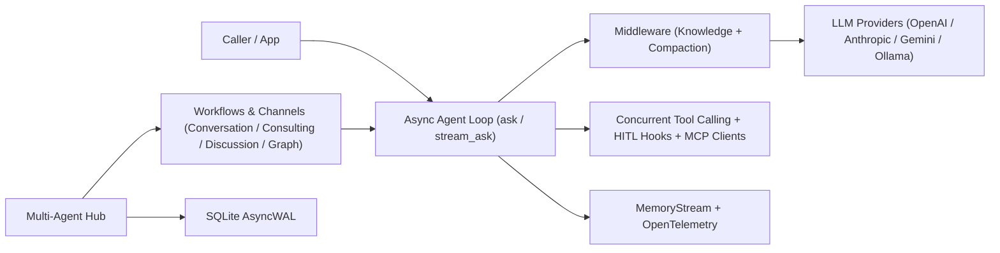

# ProtoAgent

[](https://github.com/Sehaan-1/ProtoAgent/actions/workflows/ci.yml)
[](https://www.python.org/downloads/)
[](pyproject.toml)
[](https://docs.astral.sh/ruff/)
[](https://www.apache.org/licenses/LICENSE-2.0)

ProtoAgent is a Python multi-agent framework built around asynchronous programming (`anyio` and `asyncio`) and AutoGen-style agent coordination. It pairs typed tool calling, human-in-the-loop (HITL) approval hooks, and Model Context Protocol (MCP) connections with multi-agent workflows, SQLite audit logging, and OpenTelemetry tracing.

> [!TIP]
> Run the full live showcase against OpenRouter, OpenAI, Anthropic, Gemini, or local Ollama with `uv run python examples/live_demo.py`.

## Core Capabilities

- **Asynchronous execution**: `Agent.ask()` and `Agent.stream_ask()` handle multi-turn state, streaming tokens, and structured cancellation on `anyio`.
- **AutoGen-style agent coordination**: `Hub` manages agent registries, conversation/consulting/discussion channels, conditional `TransitionGraph` multi-agent workflows, and a SQLite `AsyncWAL`.
- **Tool calling**: `@tool` turns typed Python functions into validated JSON schemas and runs tool calls concurrently per model round.
- **Human-in-the-loop workflows**: Tools receive an injected `Context` to pause and ask humans via callback, async queue, or CLI hooks.
- **MCP support**: `MCPSession` connects agents to external MCP servers over stdio and HTTP for tool and resource discovery.

## Architecture



<details>
<summary>Package layout (12 modules with test-enforced dependency boundaries)</summary>

| Module | Purpose |
| --- | --- |
| `config/` | Pydantic provider configs and environment key lookup |
| `events/` | Chat message models, usage stats, and `MemoryStream` pub/sub |
| `providers/` | Async and streaming clients for OpenAI, Anthropic, and Gemini |
| `tools/` | `@tool` decorator, schema validation, and parallel tool calling |
| `hitl/` | Injected `Context` and callback, queue, or CLI human-in-the-loop hooks |
| `mcp/` | MCP stdio/HTTP client sessions and native tool wrappers |
| `knowledge/` | In-memory and JSON-backed knowledge stores and retrieval tools |
| `compact/` | History compaction triggers and window/summary compactors |
| `middleware/` | Pre-request message assembly and working-memory policies |
| `agent/` | Turn loop, multi-turn `AgentReply`, and `AgentStream` |
| `network/` | `Hub` registry, `AsyncWAL`, channels, and `TransitionGraph` workflows |
| `telemetry/` | OpenTelemetry, `structlog` JSON setup, and in-memory `SpanCapture` |

</details>

## Setup

Requires Python 3.11+ and [`uv`](https://docs.astral.sh/uv/).

```bash
# Install dev dependencies
uv sync --locked --dev

# Or include all optional provider, MCP, storage, and telemetry extras
uv sync --all-extras
```

Set at least one provider API key when running live model calls (or use local Ollama without a key):

- `OPENROUTER_API_KEY`
- `OPENAI_API_KEY`
- `ANTHROPIC_API_KEY`
- `GEMINI_API_KEY` (or `GOOGLE_API_KEY`)

## How to Use

### 1. Run the live showcase

`examples/live_demo.py` detects whichever key is set in your environment and runs streaming tool calls, Pydantic structured output, knowledge middleware, and a multi-agent workflow with WAL + OpenTelemetry spans:

```bash
uv run python examples/live_demo.py

# Pick a specific scenario or local Ollama model
uv run python examples/live_demo.py --scenario tools
uv run python examples/live_demo.py --provider ollama --model llama3.2
```

### 2. Explore focused examples

Each script in [`examples/`](examples/) isolates one capability:

- [`examples/quickstart.py`](examples/quickstart.py): basic turn and follow-up continuation
- [`examples/multi_provider.py`](examples/multi_provider.py): concurrent Anthropic and Gemini calls
- [`examples/streaming_agent.py`](examples/streaming_agent.py): token streaming with `stream_ask()`
- [`examples/multi_agent_workflow.py`](examples/multi_agent_workflow.py): multi-agent workflow inside `Hub`
- [`examples/knowledge_agent.py`](examples/knowledge_agent.py): knowledge retrieval and middleware injection
- [`examples/telemetry_demo.py`](examples/telemetry_demo.py): self-contained `SpanCapture` demo (no API key needed)

### 3. Run checks and tests

```bash
# Run lint, format check, strict mypy, and offline tests
just check

# Or run checks individually
uv run ruff check .
uv run ruff format --check .
uv run pytest -v

# Run opt-in live API integration tests
uv run pytest -m live -v -s
```

## License

Licensed under the [Apache License 2.0](https://www.apache.org/licenses/LICENSE-2.0).
