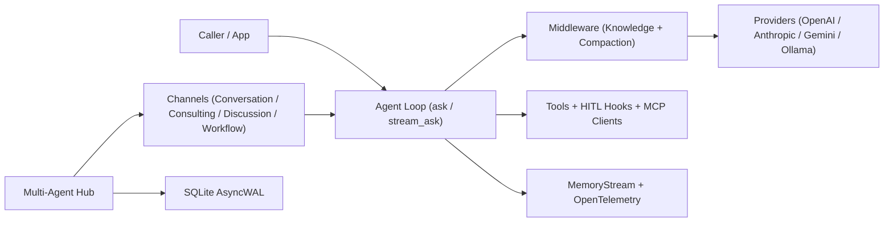

# ProtoAgent

[](https://github.com/Sehaan-1/ProtoAgent/actions/workflows/ci.yml)
[](https://www.python.org/downloads/)
[](pyproject.toml)
[](https://docs.astral.sh/ruff/)
[](pyproject.toml)

ProtoAgent is an async Python framework for building single- and multi-agent LLM workflows. It handles provider adapters, parallel tool execution, human-in-the-loop approvals, MCP integrations, SQLite audit logs, and OpenTelemetry tracing on top of `anyio`.

> [!TIP]
> You can run the full live showcase against OpenRouter, OpenAI, Anthropic, Gemini, or a local Ollama server with `uv run python examples/live_demo.py`.

## Architecture



<details>
<summary>Package layout (12 modules with test-enforced dependency boundaries)</summary>

| Module | Purpose |
| --- | --- |
| `config/` | Pydantic provider configs and environment key lookup |
| `events/` | Chat message models, usage stats, and `MemoryStream` pub/sub |
| `providers/` | `ModelClient` and streaming adapters for OpenAI, Anthropic, Gemini |
| `tools/` | `@tool` decorator, JSON schema generation, concurrent execution |
| `hitl/` | Injected `Context` and callback, queue, or CLI human approval hooks |
| `mcp/` | MCP stdio and HTTP client sessions and tool wrappers |
| `knowledge/` | In-memory and JSON-backed knowledge stores and retrieval tools |
| `compact/` | History compaction triggers and window/summary compactors |
| `middleware/` | Pre-request message assembly and working-memory policies |
| `agent/` | Turn loop, multi-turn `AgentReply`, and `AgentStream` |
| `network/` | `Hub` registry, `AsyncWAL`, channels, and `TransitionGraph` workflows |
| `telemetry/` | OpenTelemetry, `structlog` JSON setup, and in-memory `SpanCapture` |

</details>

## Setup

Requires Python 3.11+ and [`uv`](https://docs.astral.sh/uv/).

```bash
# Install dev dependencies
uv sync --locked --dev

# Or include all optional provider/MCP/telemetry extras
uv sync --all-extras
```

Set at least one provider API key when running live model calls (or use local Ollama without a key):

- `OPENROUTER_API_KEY`
- `OPENAI_API_KEY`
- `ANTHROPIC_API_KEY`
- `GEMINI_API_KEY` (or `GOOGLE_API_KEY`)

## How to Use

### 1. Run the live showcase

`examples/live_demo.py` detects whichever key is set in your environment and runs streaming tool calls, Pydantic structured output, knowledge middleware, and a multi-agent workflow with WAL + OpenTelemetry spans:

```bash
uv run python examples/live_demo.py

# Pick a specific scenario or provider
uv run python examples/live_demo.py --scenario tools
uv run python examples/live_demo.py --provider ollama --model llama3.2
```

### 2. Explore focused examples

Each script in [`examples/`](examples/) isolates one part of the framework:

- [`examples/quickstart.py`](examples/quickstart.py): basic turn and follow-up continuation
- [`examples/multi_provider.py`](examples/multi_provider.py): concurrent Anthropic and Gemini calls
- [`examples/streaming_agent.py`](examples/streaming_agent.py): token streaming with `stream_ask()`
- [`examples/multi_agent_workflow.py`](examples/multi_agent_workflow.py): graph workflow inside `Hub`
- [`examples/knowledge_agent.py`](examples/knowledge_agent.py): knowledge retrieval and middleware injection
- [`examples/telemetry_demo.py`](examples/telemetry_demo.py): self-contained `SpanCapture` demo (no API key needed)

### 3. Run checks and tests

```bash
# Run lint, format check, strict mypy, and offline tests
just check

# Or run checks individually
uv run ruff check .
uv run ruff format --check .
uv run pytest -v

# Run opt-in live API integration tests
uv run pytest -m live -v -s
```
